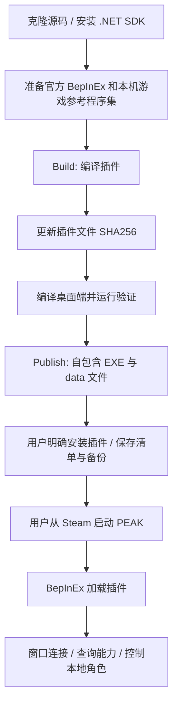
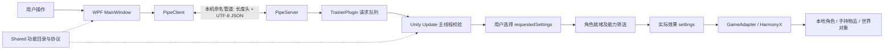

# 这次我一定要爬到顶 · PEAK Workshop

用于 PEAK 的独立桌面修改器。桌面端使用 **C# / WPF**，游戏端使用 **C# / BepInEx Mono / HarmonyX**；通过本机命名管道通信。

本仓库保存最新源码、构建及验证脚本、功能说明、开发准备与分析资料。**不提交编译后的 EXE、DLL、压缩包，也不提交游戏程序集、原修改器程序、账号凭据、个人设置、日志或备份。** 构建产物在本地产生。

## 新电脑首次使用：从下载源码到打开修改器

**本仓库提供源码。你需要先生成一次完整运行目录，再打开其中的 EXE。以后日常使用直接打开 EXE，无需重复构建，也无需编写代码。**

如果你已经安装 Windows x64、Steam PEAK 和 **.NET SDK 10.0.403 x64**，从第 2 步开始；安装后仍需在第 3 步确认 SDK 能被找到。

### 第 1 步：准备电脑和游戏

1. 使用 Windows 10/11 x64。
2. 在 Steam 中安装 PEAK，至少正常启动一次，再退出游戏。
3. 从 [.NET 10 官方下载页](https://dotnet.microsoft.com/download/dotnet/10.0)安装 **SDK 10.0.403、Windows x64**。下载的是 SDK，不是只有 Runtime 的运行时安装包。版本选择规则见下文环境说明。
4. 如果刚安装完 SDK，请关闭原来的命令行窗口，后面重新打开，让新的窗口读取更新后的 PATH。

不需要安装 Visual Studio、C# 编辑器、Python 或 Node.js。PowerShell 随 Windows 提供。

### 第 2 步：把源码完整放到电脑上

不使用 Git 也可以下载：

1. 打开[本仓库首页](https://github.com/caozichen/peak--modifier-e66)。仓库已公开，下载源码无需 GitHub 登录。
2. 点击绿色 **Code** 按钮，选择 **Download ZIP**。
3. 在文件资源管理器中找到下载的 ZIP，右键选择“全部解压缩”，解压到自己有写权限的文件夹。
4. 进入解压后的源码根目录。这个目录中应能同时看到 **`README.md`、`global.json`、`scripts`、`Desktop`、`Plugin`**。GitHub 下载的 ZIP 常多包一层目录，必要时再进入一层。

不要在 ZIP 的预览窗口里执行脚本。后面的命令都在上述源码根目录执行。

如果已安装 Git，也可以在 PowerShell 中执行以下两行，然后继续下一步：

```powershell
git clone https://github.com/caozichen/peak--modifier-e66.git
cd peak--modifier-e66
```

### 第 3 步：在源码目录打开 PowerShell，确认环境

1. 在文件资源管理器中打开刚才的源码根目录。
2. 点击顶部显示文件夹路径的**地址栏**，输入 `powershell`，按回车。这样打开的 PowerShell 会位于当前源码目录。
3. 在新窗口中逐行输入或粘贴下面两条命令，每条输入后按回车：

```powershell
Test-Path .\scripts\Publish-Portable.ps1
dotnet --version
```

第一条应显示 **`True`**；如果显示 `False`，说明当前目录不对，请回到能看到 `scripts` 文件夹的源码根目录重新打开 PowerShell。第二条应找到 `global.json` 指定的 SDK；基线版本为 **10.0.403**，同一 `10.0.4xx` feature band 的后续补丁也按仓库配置允许。

如果提示“找不到 dotnet”或“找不到兼容的 SDK”，请先检查 SDK 版本、x64 安装是否完成，再重新打开窗口。

### 第 4 步：允许当前窗口执行仓库脚本

在同一个 PowerShell 窗口执行：

```powershell
Set-ExecutionPolicy -Scope Process Bypass
```

如果询问是否更改执行策略，输入 `Y` 后回车。此设置只对**当前 PowerShell 进程**有效；关闭窗口后，下一次操作需要重新执行这条命令。

### 第 5 步：准备 BepInEx 游戏插件加载器

**BepInEx 是让 PEAK 加载本项目插件的加载器。** 窗口通过该插件连接游戏。这里使用 **BepInEx 5.4.23.6、Windows x64 Mono 版**。

在源码根目录执行：

```powershell
.\scripts\Prepare-Dependencies.ps1
```

脚本会下载官方固定版本的 ZIP，检查 SHA256，再解压到源码目录的 `.dependencies` 文件夹。看到 **`Prepared BepInEx 5.4.23.6 x64 Mono:`** 就表示准备完成。

这一步只是在源码目录准备构建和发布材料，**还没有向游戏目录安装插件**。首次安装到游戏目录由第 8 步的窗口处理，不需要你手工复制 DLL。

如果自动下载失败：

1. 打开 [BepInEx 5.4.23.6 官方发布页](https://github.com/BepInEx/BepInEx/releases/tag/v5.4.23.6)。
2. 在 Assets 中下载 **`BepInEx_win_x64_5.4.23.6.zip`**，保留 ZIP 文件即可。不要改用 x86、IL2CPP 或其他版本。
3. 执行下面命令，把引号中的路径改成你下载的 ZIP 的完整路径：

```powershell
.\scripts\Prepare-Dependencies.ps1 -BepInExArchive 'D:\Downloads\BepInEx_win_x64_5.4.23.6.zip'
```

如果之前已经成功执行过准备脚本，可以跳过这一步。默认脚本使用的是**源码目录里的依赖副本**；仅仅在游戏目录已经装过 BepInEx，不代表这里已经准备完成。使用自己的完整加载器目录作为构建材料的方法见后面的开发者说明。

### 第 6 步：找到并填入你自己的 PEAK 安装路径

1. 打开 Steam，进入“库”。
2. 右键 PEAK，打开“属性” → “已安装文件” → “浏览”。
3. 在打开的文件资源管理器中，确认当前文件夹里能看到 **`PEAK.exe` 和 `PEAK_Data`**。
4. 点击地址栏，复制整个文件夹路径。
5. 回到刚才的 PowerShell，把下面示例中的路径替换成你自己的路径，再执行：

```powershell
$env:PEAK_GAME_DIR = 'D:\SteamLibrary\steamapps\common\PEAK'
```

上面的 `D:` 只是示例，你的游戏可以在其他盘。填写包含 `PEAK.exe` 的文件夹，路径末尾不要额外添加 `PEAK.exe` 或 `PEAK_Data`。

可以再执行这两条检查，正常应都显示 `True`：

```powershell
Test-Path (Join-Path $env:PEAK_GAME_DIR 'PEAK.exe')
Test-Path (Join-Path $env:PEAK_GAME_DIR 'PEAK_Data\Managed\Assembly-CSharp.dll')
```

### 第 7 步：一次生成可以运行的完整程序

在同一个 PowerShell 窗口执行：

```powershell
.\scripts\Publish-Portable.ps1 -GameDir $env:PEAK_GAME_DIR
```

这条命令会依次**编译游戏插件、更新本次插件的文件哈希、构建并发布桌面窗口、复制加载器及插件、生成运行清单与使用说明**。首次运行需要从 NuGet 下载自包含运行所需的包，耗时取决于网络。

首次生成请使用上面这条命令，**不要额外加 `-SkipBuild`**；该选项只适用于已经完成本次 Release 构建的开发流程。

成功时，结尾会显示 **`Portable folder prepared:`** 和生成目录。默认目录结构为：

```text
源码根目录/
└─ artifacts/
   └─ 这次我一定要爬到顶/
      ├─ PeakWorkshop.exe
      ├─ Launch.cmd
      ├─ data/
      ├─ logs/
      ├─ backups/
      └─ settings.json
```

看到 EXE 后请保留整个“这次我一定要爬到顶”文件夹。`data` 中的加载器和插件也是运行流程的一部分，只拿走 EXE 会导致安装管理功能缺少文件。

### 第 8 步：第一次打开窗口、安装插件，再启动游戏

1. 确认 PEAK 已正常退出。安装或替换游戏插件时需要游戏关闭。
2. 在文件资源管理器中进入 `artifacts\这次我一定要爬到顶`，双击 **`PeakWorkshop.exe`**。也可以在刚才的 PowerShell 中执行：

```powershell
& '.\artifacts\这次我一定要爬到顶\PeakWorkshop.exe'
```

3. 首次打开会进入“游戏与插件”。核对自动找到的游戏路径是否正确；找不到、找到多个副本或选错时，使用“手动选择”指定第 6 步确认的目录。
4. 点击“安装游戏插件”，等待窗口显示安装完成。已有未知加载器、冲突插件或文件权限问题时，先按提示处理，再重新检查。
5. 点击“完成，返回修改器”。
6. 从 **Steam** 启动 PEAK，保持修改器窗口打开。
7. 等待窗口连接游戏。进入能够控制本地角色的状态后，可用功能的开关和倍率输入才会开放；按需逐项开启。

首次启动全部功能默认关闭，这是正常行为。安装成功后，不要在游戏仍运行时反复替换 DLL。

### 第 9 步：以后怎么使用、什么时候需要重新构建

- **日常使用：** 打开已经生成的 `PeakWorkshop.exe`，再从 Steam 启动游戏，等待连接即可。不需要重新下载依赖或重新执行构建命令。
- **把生成的程序交给另一台电脑运行：** 复制整个干净的便携目录，运行者无需另装 .NET SDK 或 .NET 运行时；目标电脑仍需 Windows x64 和 PEAK，并完成本机插件部署。
- **更新源码后：** 重新运行发布脚本，并提供一个新的输出目录。依赖版本没有变化且已完整准备时，可复用原来的依赖材料。
- **保留安装管理能力：** 使用后的 `backups` 和安装记录请随整个便携目录保留；不要把个人设置、日志、备份作为干净分发包转给别人。

如果默认输出目录已经存在，脚本会停止，防止覆盖设置和备份。如果只是要使用程序，直接打开原 EXE；如果确实要重新构建，可改用新目录，例如：

```powershell
.\scripts\Publish-Portable.ps1 -GameDir $env:PEAK_GAME_DIR -OutputDir '.\artifacts\再次构建\这次我一定要爬到顶'
```

### 首次使用常见问题

| 看到的提示 / 现象 | 如何处理 |
| --- | --- |
| `Test-Path` 显示 `False` | 检查 PowerShell 是否在源码根目录；检查填写的是包含 PEAK.exe 的游戏目录 |
| 找不到 `dotnet` / 找不到兼容 SDK | 安装 10.0.403 x64 SDK，或仓库允许的同一 feature band 后续补丁；安装后重新打开 PowerShell |
| 系统禁止运行脚本 | 在当前 PowerShell 窗口重新执行第 4 步的进程级设置 |
| BepInEx 下载失败、SSL 或连接错误 | 使用第 5 步的官方 ZIP 手动下载方式，再用 `-BepInExArchive` 准备 |
| 依赖目录已经存在 | 已完整准备成功的可以复用；准备中断、不完整时使用新的干净源码目录重试 |
| `NU1301` / 无法访问 NuGet 源 | 检查到 nuget.org 的网络连接；离线构建还需事先准备完整 NuGet 本地包源并传入 `-NuGetConfig`，只有 BepInEx ZIP 不够 |
| 输出目录已存在 | 日常使用直接打开其中的 EXE；重新构建时用 `-OutputDir` 指定新的目录 |
| 尚未检测到游戏 / 尚未连接插件 | 核对选中的游戏目录、插件安装结果，以及 Steam 启动的是否为同一个 PEAK 副本 |
| 等待本地角色就绪 / 控件灰色 | 等到角色可控制并查看具体提示；仍不正常时，在“游戏与插件”收集日志，再检查游戏目录的 BepInEx/LogOutput.log |

后面保留完整环境表、开发者构建与验证命令、功能清单和架构说明，供排查问题与后续开发使用。

---

| 组件 | 当前版本 / 目标 |
| --- | --- |
| 桌面窗口 | 0.3.2；`net10.0-windows`、WPF、Windows x64 |
| 游戏插件 | 0.2.6；`netstandard2.1` 项目，显式引用游戏 Mono 基础程序集 |
| 加载器 | BepInEx 5.4.23.6，Windows x64 **Mono** |
| 通信协议 | v2；51 项持续控制 + 独立的一键清除状态操作 |
| SDK | .NET SDK 10.0.403；`global.json` 允许同一 feature band 的后续补丁 |

## 1. 先准备什么环境

### 只负责运行和游戏测试

| 必需项 | 说明 |
| --- | --- |
| Windows x64 | 建议 Windows 10/11 x64；当前桌面程序不能在 macOS/Linux 运行 |
| Steam 与 PEAK | 安装 PEAK，至少正常运行过一次；Steam App ID：3527290 |
| 自包含便携目录 | 由开发者按下文生成；解压后运行 `PeakWorkshop.exe` |
| 可写文件夹 | 程序需要在自身目录保存设置、日志及安装备份 |

运行自包含便携版**无需安装 C#、Visual Studio、.NET SDK 或单独的 .NET 运行时**。C# 是开发语言，不是一个需要给运行者安装的软件。BepInEx 和本插件在首次使用时由窗口部署到游戏目录。

### 编译、维护源码

| 工具 / 材料 | 是否必需 | 获取 / 用途 |
| --- | --- | --- |
| Git | 获取、提交源码时需要 | [Git for Windows](https://git-scm.com/download/win) |
| .NET SDK 10.0.403 x64 | 必需 | [.NET 10 下载](https://dotnet.microsoft.com/download/dotnet/10.0)；`dotnet --version` 验证；便携 SDK 也可 |
| Windows PowerShell 5.1 或 PowerShell 7 | 必需 | 执行仓库脚本；5.1 随 Windows 提供 |
| 本机 PEAK 的 `PEAK_Data/Managed` | 编译插件及部分测试必需 | 从自己的游戏安装读取；不要将游戏 DLL 提交到仓库 |
| BepInEx 5.4.23.6 x64 Mono 原版 ZIP | 必需 | 运行依赖准备脚本下载，或传入自己下载的 ZIP |
| Visual Studio / VS Code | 可选 | 查看与调试源码；命令行构建不需要安装 IDE |
| Python、Node.js、ILSpy | 当前标准构建不需要 | 历史分析工具可另行使用，构建流程使用 PowerShell 和 .NET |

`global.json` 固定 SDK，安装其他大版本 SDK 不会自动替代它。首次 restore/publish 可能从 NuGet 下载 Windows Desktop 与自包含运行包。断网构建可传 `-NuGetConfig` 指向自己的离线源；仓库不包含预下载 SDK 或 NuGet 缓存。

## 2. 开发者完整构建与验证命令

以下命令在 **PowerShell** 执行。将示例游戏路径改成自己的安装目录；默认不写死盘符。构建只读取游戏参考文件，不自动安装插件或启动游戏。

```powershell
git clone https://github.com/caozichen/peak--modifier-e66.git
cd peak--modifier-e66
# 公开仓库可以匿名克隆；也可在仓库网页使用 Code → Download ZIP。

dotnet --version
$env:PEAK_GAME_DIR = 'D:\SteamLibrary\steamapps\common\PEAK'

# 只对当前 PowerShell 进程允许执行本地脚本，不修改全局执行策略。
Set-ExecutionPolicy -Scope Process Bypass

# 下载官方固定版本并校验 ZIP 的 SHA256，解压到 .dependencies/。
.\scripts\Prepare-Dependencies.ps1

# 先构建插件，更新本次插件文件的完整性哈希，再构建桌面端。
.\scripts\Build.ps1 -GameDir $env:PEAK_GAME_DIR

# 自动化回归；不会启动游戏、连接真实游戏管道或安装游戏补丁。
.\scripts\Test.ps1 -GameDir $env:PEAK_GAME_DIR

# 生成本地可运行的自包含目录，不生成 ZIP。
.\scripts\Publish-Portable.ps1 -GameDir $env:PEAK_GAME_DIR -SkipBuild

# 然后手动启动窗口；请继续按下一节部署插件。
& '.\artifacts\这次我一定要爬到顶\PeakWorkshop.exe'
```

若无法自动下载 BepInEx，可从[官方发布页](https://github.com/BepInEx/BepInEx/releases/tag/v5.4.23.6)获取 `BepInEx_win_x64_5.4.23.6.zip`，再执行：

```powershell
.\scripts\Prepare-Dependencies.ps1 -BepInExArchive 'D:\Downloads\BepInEx_win_x64_5.4.23.6.zip'
```

依赖目录存在时准备脚本会停止，避免混合旧文件；已成功准备后直接使用它。也可向 Build、Test、Publish 脚本传入 `-BepInExDir '...\BepInEx\core'`。发布时需要这个 core 所属的完整原版加载器目录，仅复制两个引用 DLL 不够。

三个脚本都接受 `-NuGetConfig 'D:\offline\NuGet.Config'`。`Build.ps1` 自动将新插件 SHA256 写回 `Desktop/InstallationPolicy.cs`，这是**安装文件完整性检查**，与游戏版本限制无关。修改插件后应重新构建、验证、发布，不能只替换 payload 中 DLL 而保留旧清单。`-SkipBuild` 只用于刚刚完成 Release 构建的情况。

脚本拒绝覆盖已存在的发布目录，以保护其运行设置和备份。再次发布请提供新的目录：

```powershell
# 要生成压缩包时显式加 -Zip；源码推送不会上传这些本地产物。
.\scripts\Publish-Portable.ps1 -GameDir $env:PEAK_GAME_DIR `
    -OutputDir '.\artifacts\下一次测试\这次我一定要爬到顶' -Zip
```

只运行 `dotnet run` 会得到缺少 `data/` 的开发输出，不能完整使用安装管理器。日常测试请使用生成的便携目录。

## 3. 首次安装、测试与卸载

1. 将完整便携目录放在可写位置。关闭 PEAK 后启动 `PeakWorkshop.exe`。
2. 在“游戏与插件”中自动扫描 Steam 游戏库；找不到或找到多个副本时手动选定正确目录。程序检查 `PEAK.exe` 和 Managed 文件。
3. 点击“安装游戏插件”。安装会校验随包文件、已有加载器和目录权限，记录清单与备份。匹配的现有加载器可复用；未知或冲突文件会明确提示，不会直接覆盖。
4. 从 Steam 启动 PEAK。窗口自动连接插件，角色就绪后开启所需功能。机场可控制的本地角色也应可识别。
5. 机场 → 地图 → 结算回机场时，保留本窗口的开关与倍率；加载过程中暂停效果，角色就绪后恢复应用。
6. “恢复全部”会清空选择；“停用插件”清空选择、恢复本插件可撤销的效果、撤销自身补丁，先回执再停止通信。窗口保留“已停用”，游戏重启后才能重新加载插件。
7. 卸载前关闭游戏，通过“游戏与插件”卸载。只处理本目录安装清单中归本程序管理、且未被后来修改的文件；发现其他 Mod 时保留共享加载器。

DLL 已进入游戏运行时后不会强制从进程卸载，随 PEAK 退出释放。关闭桌面窗口再打开默认关闭全部功能；保存的倍率不等于自动恢复开启状态。重启游戏后的新会话也从关闭状态开始；同一游戏进程内的切图和短暂断线则保留选择。

旧 CMD 本地升级包的根目录 `installed-files.json` 与新版界面 `backups/` 中的安装记录分别管理。旧安装应使用原包的卸载入口；界面发现相同但不归本包所有的插件时可以连接，不会接管卸载。历史脚本在 `scripts/legacy/`，不是当前首次安装入口。

## 4. 功能结构

| 分组 | 数量 | 功能与范围 |
| --- | ---: | --- |
| 移动与攀爬 | 6 | 移动速度 0.5–200×、攀爬速度 0.2–200×、跳跃高度 0.2–200×、抗摔能力 0.1–200×、防止摔倒、防滑 |
| 体力 | 5 | 无限体力、体力/攀爬消耗 0–5×、体力恢复 0–10×、恢复等待 0–10 秒 |
| 状态效果 | 3 | 不再增加负面状态、负面状态增加倍率 0–5×、无视物品负重 |
| 单项状态 | 30 | 15 种状态各有“不再增加”和“增加倍率 0–5×” |
| 物品 | 4 | 无限灯笼燃料、燃料消耗 0–5×、物品无限使用、标记手势大小 0.1–50× |
| 迷雾 | 3 | 暂停迷雾推进、推进速度 0–5×、看穿迷雾；推进控制需要房主权限 |
| 独立操作 | 1 次性按钮 | 顶部“一键清除当前状态”；不改变持续功能选择，不在重连后自动重放 |

15 种状态：受伤、饥饿、寒冷、中毒、螃蟹、诅咒、困倦、负重、炎热、荆棘、孢子、蛛网、箭伤、石化、捕蝇草。

完整 ID、名称、范围和语义见 [功能说明](docs/features.md)，原名称到易懂名称的映射见 [名称对照](docs/feature-name-mapping.md)。目录唯一依据是 `Shared/FeatureCatalog.cs`。左侧菜单定位同一个完整功能列表，滚动时同步高亮；搜索与可用性筛选独立生效。

**已有状态的清除和阻止新状态增加是两件事。** 清除按钮调用游戏的治疗及拔刺流程，持续环境、携带物品、螃蟹等来源仍可能重新施加状态。跳跃与抗摔数值分别调整对应计算参数，界面数值不保证实际高度或安全跌落距离严格等比例增加。

## 5. 工作流程与架构





场景变化、角色重建、昏迷/死亡、短暂失联时，清理旧对象上的效果，保留用户选择；恢复后按当前能力重新应用。会话、窗口 `controllerId`、请求 ID 和状态修订号用于拒绝旧操作；不会把上个场景排队的一次性清除重放到新角色。详见 [架构与生命周期](docs/architecture.md)。

## 6. 代码结构

```text
Desktop/                  C# WPF 窗口、安装管理、发现与诊断
  MainWindow.xaml(.cs)    完整功能列表、菜单锚点、开关和倍率
  MainWindow.VersionInfo.cs / GameVersionInfo.cs
                          Steam Build、程序集 SHA256、可读悬浮提示及复制
  SetupWindow.xaml(.cs)   游戏目录、安装/更新/卸载/恢复和日志收集入口
  InstallationService.cs  文件事务、备份、所有权和回滚
  InstallationPolicy.cs   随包文件哈希、插件版本、历史分析基线
  SteamDiscovery.cs       注册表、Steam 库 VDF 与 appmanifest 扫描
  PipeClient.cs           连接、请求序列化、超时、窗口身份和响应校验
  PortableEnvironment.cs  EXE 旁设置/日志/备份及路径保护
Plugin/                   BepInEx 游戏内插件
  TrainerPlugin.cs        初始化、主线程请求处理、会话与停用流程
  GameAdapter.cs          本地角色识别、请求配置与实际效果、资源清理
  ActorFeatures.cs        移动、攀爬、跳跃、体力、状态相关补丁
  GameAdapter.World.cs    物品、手势、迷雾及临时材质恢复
  GameAdapter.ClearStatus.cs / GameAdapter.Capabilities.cs
                          单次清除、分项能力及失败原因
  FeatureSettings.cs      不可变的完整设置快照与范围校验
  PipeServer.cs / SecurePipeFactory.cs / WireJson.cs
                          本机管道、权限、生命周期、Mono 兼容 JSON
Shared/                   两端共用功能目录、协议和管道身份
Tests/                    协议、参数、JSON、管道与释放回归
validation/               控制器、角色生命周期、UI、发现、安装、世界、IL 分析
scripts/                  依赖准备、构建、验证、生成便携目录
  legacy/                 旧 GameFiles 部署和 0.2.5→0.2.6 升级资料
examples/                 不含本机信息的设置示例
licenses/                 第三方许可证文本
docs/                     说明、验证计划、当前开发计划及历史分析
global.json               SDK 固定版本
NuGet.Config              默认 NuGet 源
Directory.Build.props     本机引用参数
.gitignore / .gitattributes
                          排除规则与文本格式
```

## 7. 配置、日志和版本提示

便携目录运行时结构：

```text
这次我一定要爬到顶/
  PeakWorkshop.exe         双击入口；Launch.cmd 是可选 CMD 入口
  data/game-files/         加载器和编译出的本插件
  data/payload.json        安装载荷清单，与窗口内嵌哈希相互核对
  data/licenses/           第三方说明
  settings.json            本机游戏路径与有效倍率；不自动恢复功能开启
  logs/                    窗口日志、主动收集的诊断
  backups/                 安装清单、事务与备份；请随整个目录保留
```

全部以 EXE 所在目录为基准，快捷方式的工作目录不会改变保存位置。BepInEx 的原始日志仍位于游戏目录 `BepInEx/LogOutput.log`；诊断功能复制有限长度的日志尾部及版本信息到便携目录，不自动上传。

右上角显示当前游戏 Build/程序集 SHA256，以及修改器与历史分析基线；悬浮可读完整 Hash，点击复制。**当前版本没有游戏程序集哈希白名单，不会因为游戏版本与历史基线不同而禁止安装或连接。** 文件完整性、游戏接口可用性、参数范围和本地角色/房主权限检查继续存在；缺失接口的功能会显示具体原因。

## 8. 验证与常见问题

执行 `scripts/Test.ps1` 的报告写入 `artifacts/tests/`。这些检查覆盖真实生产通信代码、控制器与适配器的受控替身、实际编译的 WPF 窗口和独立文件系统夹具；不会代替真实游戏效果和长时间资源测试。当前验证结果与人工测试矩阵见 [验证说明](docs/testing.md)。

| 现象 | 优先检查 |
| --- | --- |
| 尚未检测到游戏 | 是否选中正确 PEAK 目录；是否从 Steam 启动了该副本 |
| 游戏运行但连接超时 | 游戏日志是否显示本插件初始化；加载器须为 Mono x64；是否在运行旧 DLL；收集两端日志 |
| `IPC: NotImplementedException` | 使用当前 SecurePipeFactory/WireJson 实现；旧版依赖了 Unity Mono 不完整实现的接口 |
| 等待本地角色就绪 / 控件灰色 | 查看插件上报的具体原因；当前机场识别不再依赖登山统计对象；分项缺失会单独禁用 |
| 游戏版本与历史 Hash 不同 | 提示仅供诊断，无需绕过版本限制；当前已无整程序集 Hash 拦截 |
| payload 校验失败 | 本次编译 DLL、内嵌策略与 payload.json 是否一起重新生成；不要混用旧 EXE 和新 DLL |
| 不能自动卸载现有插件 | 检查是否由另一个便携目录或旧 CMD 包安装；本包不会接管未知安装记录 |
| 切图后选择还在但效果暂停 | 等本地角色就绪；确认当前能力与房主权限，暂停不应清除选择 |
| 依赖下载失败 | 检查网络或用本地原版 ZIP；NuGet 可使用自备离线源 |

更多资料：[开发计划](docs/development-plan.md) · [依赖与分发](docs/dependencies.md) · [版本变更](docs/changelog.md) · [使用说明](docs/user-guide.md) · [第三方说明](THIRD-PARTY-NOTICES.md)。
