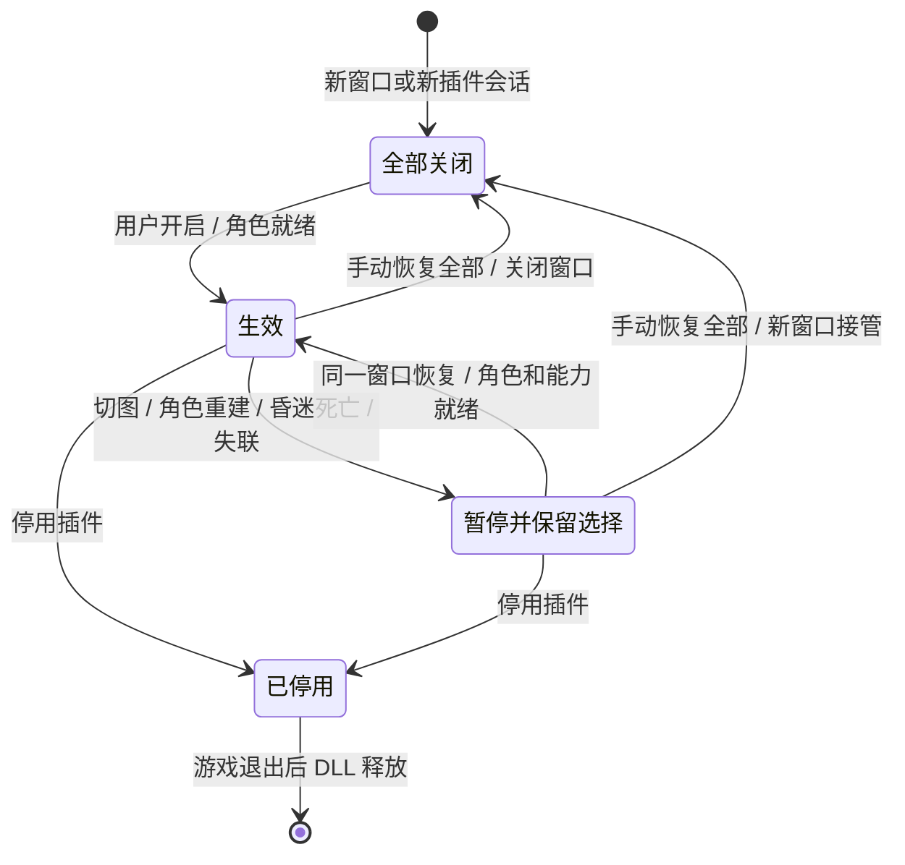
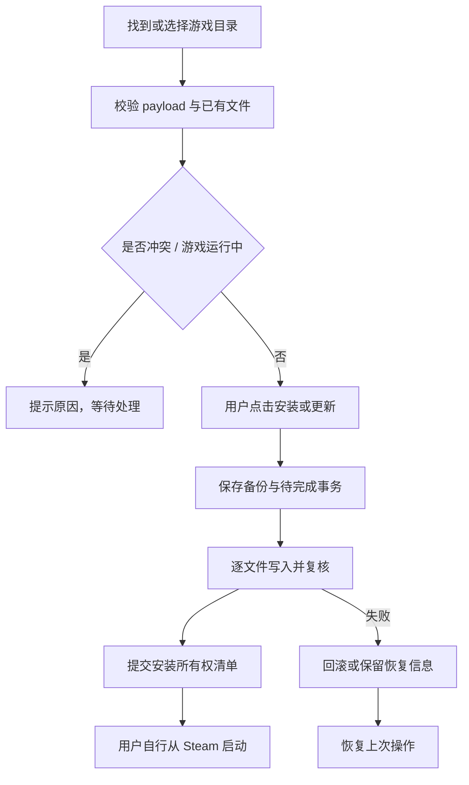

# 架构、状态与资源生命周期

## 两个执行环境

桌面是 .NET 10 Windows Desktop / WPF 程序；插件由游戏里的 BepInEx Mono 加载。两端共享 C# 源文件，不共享 .NET 运行时。插件项目的 `NoStdLib` 和显式 Mono 基础库引用用于匹配 HarmonyX 的 emit 签名，不能直接改为引用桌面运行库。

桌面不执行远程内存扫描或凭据操作。游戏对象和 Harmony 操作全部位于插件内，由 Unity `Update` 主线程处理；管道后台线程负责字节收发并将请求提交队列。

## 协议 v2

每帧为 4 字节小端长度头和 UTF-8 JSON，单帧上限 65,536 字节。传输使用字节模式本机命名管道，名称前缀 `PeakWorkshop.v2.`，带进程/用户身份信息，服务端限制访问账户并验证本机客户端。Windows ACL 与句柄创建在 `SecurePipeFactory.cs` 中实现，避免依赖 Unity Mono 不支持的部分托管构造接口。

主要请求为 `state`、`set`、`reset`、`clear_status`、`detach`。`features` 必须是完整 51 项数组；不接受重复/未知/缺项 ID、非有限数字或超出范围的数值。`WireJson.cs` 是插件侧 JSON 边界，桌面使用 System.Text.Json。实际协议定义以 `Shared/WireMessage.cs` 为准。

`requestId` 对应回复；`sessionId` 区分游戏插件会话；`stateRevision` 使场景变化、重置或控制器变化之前排队的修改失效。`controllerId` 对每个桌面 PipeClient 实例保持稳定，同一窗口重连可恢复，新窗口不会继承旧窗口开启状态。查询可重新连接；改变设置与单次清除不会在通信中断后盲目重试。

## 用户选择与实际效果

`GameAdapter._requestedSettings` 保存不可变用户选择，`Settings` 对外暴露它；`_settings` 是实际补丁读取的生效配置。`SuspendEffects()` 清理旧角色/世界对象上可恢复的修改，不清除 requested；`RefreshEffects(controlActive)` 仅在本地角色就绪、控制连接有效时筛选当前能力并恢复应用。该结果按选择快照和能力修订缓存，避免每帧重新分配全部配置。

机场 → 正式地图 → 结算回机场不会清空开关或倍率。失去某项接口能力或房主权限时只暂停对应效果，恢复能力后重新应用。新游戏进程的插件初始化默认关闭，桌面不会把旧会话设置自动重放过去。

## 停用与清理

停用清空选择、恢复本插件记录的临时值与材质、撤销本插件 Harmony owner 的补丁，并验证自身补丁是否仍残留。最终停用回复发送后关闭 IPC，窗口保留已停用状态。不会撤销其他插件补丁，也不强制卸载游戏运行时中的 DLL。

管道、取消源和后台任务由自身生命周期管理；错误日志限频。角色重建释放旧对象引用；迷雾显示缓存有上限，恢复材质时保留其他属性和后来第三方改动。已被游戏正常消费的物品、已经推进的迷雾等无法靠关闭功能逆转；恢复是撤销持续影响，不是回滚游戏存档。

## 安装事务

SteamDiscovery 解析注册表、libraryfolders.vdf 与 appmanifest_3527290.acf，并验证目录；多个候选由用户选择。安装管理器检查随包文件、路径链接、运行进程、现有加载器/插件和写权限后规划事务。

`InstallationPolicy` 固定 23 个载荷文件的 SHA256。历史 `SupportedGameHash` 仅作为 payload 格式中的元数据参照；实际游戏 SHA256 不参与拒绝使用的决策。文件完整性验证仍要求 payload 元数据与内嵌策略一致。

卸载只针对本便携目录拥有且内容未被外部改动的文件；其他 Mod 存在时保留共享加载器。不归本包所有但相同的插件可连接，不会自动接管卸载。
