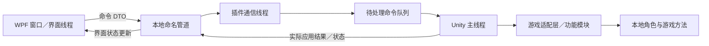

> 历史资料：记录当时的分析与计划；当前环境、状态保留策略和使用步骤以根目录 README 与 docs/architecture.md 为准。

# PEAK 自制修改器：环境准备与开发计划

编制日期：2026-10-25（北京时间）
文档用途：确定准备工作、技术路线、开发顺序、验收标准和后续维护方式。本文是计划，本轮没有安装开发环境、安装游戏插件或制作修改器。

执行分工（按你的最新要求更新）：**AI 负责代码、构建和打包，你负责运行游戏、测试功能和反馈结果。你的电脑只为运行测试准备必要组件，不要求安装 IDE 或学习编程。桌面端优先采用自包含发布，随包提供所需 .NET 运行时。** 编译工具由开发端处理；若 AI 也在这台电脑上编译，则仍需准备一份 SDK，可使用单独工具目录而非全局安装，见第 3 节。

## 1. 先确定做什么

推荐第一版采用 **C# WPF 桌面窗口＋C# 游戏插件**。窗口提供开关、倍率、快捷键和状态；插件由游戏加载，在游戏主线程处理角色及游戏逻辑；两者通过本地命名管道通信。

这里的“前端”是电脑上的桌面窗口，使用 **C#＋XAML**；“后端”是游戏进程里的功能插件，使用 **C#**。它们都在本机运行，首版不需要另租服务器、部署网站或建立数据库。WPF 是界面框架，XAML 用于描述界面布局。

交付形态是“桌面 EXE＋游戏加载器＋自制插件 DLL”。平时打开自己的窗口，在已经加载插件的游戏中操作功能。另一种常见形态是仅有外部 EXE，由它直接访问游戏内存；它需要额外处理地址定位、内存布局和游戏更新适配。本计划优先利用已确认的 Mono 托管环境，采用插件路线；这项选择仍以空插件兼容性测试为关口。

目标是独立实现自己的代码和界面。已提取的伏特材料用于理解功能、定位相关游戏方法和研究恢复逻辑；首版不把伏特后端、账户、服务或现有游戏修改 DLL 作为必须运行的依赖。

首版完成后，应能在退出伏特、重新启动 PEAK 的条件下，由自己的插件和窗口完成连接、修改、恢复和断线处理。具体功能是否可行，仍要逐项验证。

### 首版功能范围

| 项目 | 首版目标 | 验收重点 |
|---|---|---|
| 游戏连接 | 识别游戏、插件版本、角色是否就绪、当前场景 | 游戏未启动、主菜单、实际游玩能正确区分 |
| 移动速度倍率 | 提供可开关的倍率功能 | 不逐帧叠乘；关闭后恢复；重生后对象重新定位 |
| 无限体力 | 独立控制本地角色体力相关行为 | 与体力上限、负面状态、冲刺和攀爬分别验证 |
| 恢复默认 | 关闭全部自制功能并恢复自己的修改 | 不影响其他插件的补丁和状态 |
| 快捷键 | 为上述功能配置快捷键 | 冲突、重复触发、失去连接时的行为明确 |
| 配置与日志 | 保存界面偏好、快捷键和诊断信息 | 不把“上次开启”自动等同于本次已经应用 |

第二阶段再考虑跳跃高度、攀爬速度、体力消耗／恢复倍率。雾气、全局游戏速度等会影响场景或联机共享状态的功能，单列验证后再决定是否加入。

**22 段提取模板不等于首版已经具备 22 个可独立运行的功能。** 每项仍需理解前置条件、定位方式、作用对象和关闭恢复行为。

## 2. 你电脑目前的情况

下表是本次及此前只读检查的结果，不是一次完整的软件安装审计。

| 项目 | 已观察到的情况 | 对开发的影响 |
|---|---|---|
| 游戏位置 | `<本机路径>` | 后续设置为本机游戏路径，不写死在公共源码里 |
| 游戏架构 | x64，使用 Mono；有 `Assembly-CSharp.dll` | 适合先评估 C# 游戏插件方案 |
| Unity 版本 | `6000.3.15f1 (c1aa84e375f6)`，来自 UnityPlayer.dll 产品版本 | 加载器、插件框架和补丁库需针对这个版本实测 |
| BepInEx | 常见的 `BepInEx`、`doorstop_config.ini`、`winhttp.dll` 均未发现 | 不能默认插件已经能加载；必须先验证加载环境 |
| 现代 .NET SDK | PATH 和常见安装路径未发现 `dotnet` | 不影响运行自包含成品；如果在本机编译，由 AI 准备构建工具 |
| 旧 C# 编译器 | 找到 Windows 自带的 .NET Framework `csc.exe` | 不能据此认为现代 WPF 项目的开发环境已就绪 |
| Git | 本会话能使用随运行环境提供的 Git | 在以后使用的独立开发终端里还要验证是否可用 |
| Node.js／npm | 已找到 Node.js 和 npm | 当前推荐方案不依赖它们，不需要为首版增加网页构建链 |
| JSON 库 | 游戏 Managed 目录中有 `Newtonsoft.Json.dll` | 先记录版本；若使用它，避免重复装载冲突版本 |
| 已提取材料 | 前端 36 项、后端 164 项、5,817 个方法的 IL、22＋2 段脚本等 | 已有分析基础，但尚无自制功能的独立运行验证 |

`version.txt` 中出现过 `3.0.1--logFile` 等文本，暂不把它作为已经确认的游戏语义版本。版本基线应同时记录 Unity 版本、Steam 构建信息（可获得时）和关键程序集的 SHA-256。

## 3. 要准备哪些环境

### 3.1 你负责运行测试，需要准备什么

| 环境／组件 | 运行时是否需要 | 你现在要做什么 |
|---|---|---|
| 受支持的 x64 Windows | 需要 | 继续使用现有系统；只读检查显示系统为 x64、构建 26200，后续按所选 .NET 支持表核对 |
| 能正常启动的 PEAK | 需要 | 已找到现有游戏；保留正常游戏基线 |
| 自包含桌面程序包 | 需要，由 AI 构建后提供 | 成品出来后解压并运行，暂时没有新程序需要安装 |
| 兼容的游戏插件加载器 | 本计划的插件路线需要 | BepInEx Windows x64／Mono 是候选；等待确认精确版本后再部署 |
| 自制插件及所需依赖 | 需要，由发布包提供 | 后续按部署清单放入游戏目录，不要求你自行寻找 DLL |
| .NET Desktop Runtime | 自包含桌面包随附所需运行时，无需单独安装 | 现在不安装；如果以后主动改成依赖框架发布，再重新说明 |
| Visual Studio／VS Code／桌面开发工作负载 | 运行成品不需要 | 不安装 |
| .NET SDK／C# 编译器 | 运行成品不需要 | 不作为你的运行前置；编译端需求见下一节 |
| Node.js／Python／Git／Unity Editor／C++ 开发工具 | 本首版成品运行不需要 | 不为本项目额外安装；已有软件无需卸载 |

**C# 是编程语言，不是需要单独安装的运行软件。** 自包含发布把桌面程序需要的 .NET 运行时带在发布包里，但仍要求操作系统受支持，并不自动包含或替代游戏加载器。游戏插件使用 PEAK 自带的 Unity／Mono 环境，通常不需要另外安装一个系统级 Mono。

目前尚未发现游戏目录里的常见 BepInEx 文件。因此，对运行端真正待验证的新增组件，是加载器和自制插件。现在只做规划，不提前混装候选加载器。

### 3.2 AI 开发和编译时需要什么

AI 写出的 C# 源码也必须通过编译器生成 EXE／DLL。是否由你编写代码，不会改变这一点；区别在于谁准备和使用构建工具。

| 工具／依赖 | 用途 | 本计划如何处理 |
|---|---|---|
| .NET SDK | 还原依赖、编译、测试、发布桌面端和插件 | 由开发端准备；桌面端优先 .NET 10 LTS x64 SDK，核对支持状态后锁定版本 |
| Visual Studio | 图形化编辑与调试 | 可选；AI 可以使用 SDK 命令行构建 WPF，不以安装完整 IDE 为前置 |
| Git | 版本记录和回滚 | 由 AI 使用现有可用工具，不要求你单独安装 |
| 游戏本机程序集引用 | 编译游戏适配代码 | AI 从本机指定路径引用，不随产品复制整套游戏 DLL |
| 加载器、目标框架引用包、HarmonyX 等 | 编译及运行插件 | 由 AI 选择兼容版本、核对依赖并打包 |
| ILSpy 或同类工具 | 阅读游戏托管代码 | AI 分析时按需使用，不属于运行端前置 |
| MVVM 库、测试框架等 | 项目实现与构建验证 | 按项目需要通过包管理准备，不要求你手动逐项安装 |

若 AI 在其他已具备环境的构建机上编译，你的测试机可以完全不准备 SDK；当前尚未配置这样的构建机。若后续继续在这台电脑上完成编译，就需要一份本机 SDK。可将官方 SDK 解压到项目的专用工具目录，由 AI 指定路径调用，不改全局 PATH，也不安装完整 Visual Studio；它仍会占用磁盘并需要下载，属于构建工具，不属于成品运行依赖。本轮不执行这些操作。

### 3.3 桌面程序和游戏插件不能使用同一个运行时假设

| 组件 | 计划目标 | 原因 |
|---|---|---|
| 桌面端 | `net10.0-windows`、WPF、x64 | 在 Windows 的现代 .NET 上运行 |
| 共享协议 | 优先 `netstandard2.0` 的简单 DTO | 让现代桌面端和 Unity 插件都能引用 |
| 游戏插件 | **候选 `netstandard2.0`；如游戏引用链要求则评估 `netstandard2.1`** | 精确目标由加载器、Unity 程序集和空插件测试共同确定 |
| 游戏本体 | 使用游戏自带的 Unity／Mono 运行环境 | 不因桌面端安装了 .NET 10 就变成 .NET 10 游戏 |

**不要把 `net10.0-windows` 的 WPF DLL 直接放进 Unity 当游戏插件。** 两个进程通过协议交换数据，不互相加载对方的界面程序集。

BepInEx 5.x 稳定线的 Windows x64 Mono 包可作为初始评估候选；当前游戏是 Unity 6000.3，因此先做兼容性核对和空插件加载验证。若候选不兼容，再根据日志选择适配的 Mono 版本。一次只验证一套加载器，不把不同主版本或 Mono／IL2CPP 包混装。通过验证后记录精确版本并锁定，后续不随意换包。

HarmonyX 与普通 Harmony 的选择要跟随已验证的加载器组合；避免同时放入多个不同来源、同名的 `0Harmony.dll`。

### 3.4 安装入口与验证

这些是 AI 后续准备构建环境或核对运行组件时使用的官方入口，不是要求你逐项安装的清单。本计划没有执行下载或安装：

- [.NET 下载](https://dotnet.microsoft.com/download)
- [.NET 支持策略](https://dotnet.microsoft.com/platform/support/policy/dotnet-core)
- [Visual Studio 下载](https://visualstudio.microsoft.com/downloads/)
- [Visual Studio 工作负载说明](https://learn.microsoft.com/visualstudio/install/modify-visual-studio)
- [Git for Windows](https://git-scm.com/downloads/win)
- [BepInEx 文档](https://docs.bepinex.dev/)
- [BepInEx 发布页](https://github.com/BepInEx/BepInEx/releases)
- [ILSpy 发布页](https://github.com/icsharpcode/ILSpy/releases)
- [HarmonyX 项目](https://github.com/BepInEx/HarmonyX)

若选定在本机编译，AI 在准备 SDK 后执行以下检查；你只运行成品时无需执行。使用专用目录中的 SDK 时，以其完整路径代替 `dotnet`：

```powershell
dotnet --info
dotnet --list-sdks
dotnet --list-runtimes
git --version
```

应能看到计划使用的 SDK，并能还原和构建 WPF 所需的目标包。随后由 AI 编译一个空 WPF 项目，你运行生成的测试包验证窗口能打开和关闭。

### 3.5 电脑资源与准备成本

沿用现在能正常运行 PEAK 的电脑即可先做验证，同时核对 Windows 版本是否在所选 .NET 的支持范围内。本轮未检查 CPU、内存和磁盘余量，暂不要求硬件升级。

- 纯运行测试不需要为完整 IDE 预留几十 GB 空间；保留测试包、日志和回滚备份所需空间即可，具体容量以成品包为准。
- 若 AI 在本机编译，另外为 SDK、NuGet 缓存和构建产物留出数 GB 起的空间，实际容量取决于依赖和缓存。
- 构建端首次下载 SDK、发布包和 NuGet 依赖需要联网；成品是否需要联网取决于游戏本身，首版本地窗口与插件通信不需要另建服务器。
- 向受保护的游戏目录写入组件时，按系统实际提示处理权限；日常运行先使用普通用户权限。
- 首版本机方案没有服务器租用费用。开发和发布时，由 AI 整理实际采用组件的许可与版本。

## 4. 游戏和材料的前置准备

1. 建立一次干净基线：退出伏特及其他修改器，重新启动 PEAK，确认没有残留运行时修改，再记录游戏的正常行为。
2. 记录游戏目录、Unity 版本、关键 DLL 哈希、已有 Mod／加载器情况。后续如果新增或替换加载器文件，先备份会改动的文件和配置。
3. 源码目录与游戏目录分开。只将通过构建的插件部署到游戏中，不把整个开发项目放进 Steam 游戏目录。
4. 将提取材料保留为只读参考。大型二进制和原修改器文件不混入自制项目的日常源代码提交。
5. 创建可重复进入的测试场景。首轮先验证本地角色，再分别验证私人房间中的房主和加入者情形；不能用一种角色的结果推断所有联机情况。
6. 准备一次测试记录：游戏构建标识、角色状态、启用前数值、操作步骤、实际效果、关闭后结果和相关日志。

已整理的材料入口：

- [扩展提取阅读说明](<本机路径>)
- [代码阅读包](<本机路径>)
- [完整提取包](<本机路径>)

## 5. 项目架构与目录



所有 Unity 对象访问和游戏修改在游戏主线程完成。通信线程负责收发和解析普通数据，不能因为收到命令就直接跨线程操作角色对象。

建议项目结构：

```text
PeakTrainer/
  PeakTrainer.sln
  global.json                    # SDK 版本，在验证环境后填写
  Directory.Packages.props        # 统一管理确实采用的包版本
  src/
    PeakTrainer.Desktop/          # WPF 窗口、MVVM、快捷键、配置
    PeakTrainer.Contracts/        # 简单 DTO、功能 ID、协议版本
    PeakTrainer.Plugin/           # 插件入口、通信、主线程调度
    PeakTrainer.GameAdapter/      # 游戏方法／字段、版本和角色定位
    PeakTrainer.Features/         # 功能状态、启用、参数、恢复
  tests/
    PeakTrainer.Tests/            # 协议、范围、状态、恢复逻辑
  docs/                           # 兼容版本、测试记录、发布说明
  scripts/                        # 构建、部署、打包工具
  artifacts/                      # 构建和发布输出，通常不入 Git
```

这些是职责划分。首个原型可以先把适配层和功能层作为插件项目内的目录，避免过早拆成许多程序集；稳定后再决定是否拆项目。

本机游戏路径用用户配置或构建参数提供，例如 `PeakGameDir`，不把 `<本机路径>` 写死。游戏 DLL 的构建引用设置为不随产品复制；交付包不夹带整套游戏程序集。

Git 中保存自制源码、配置模板、文档和测试；忽略 `bin`、`obj`、本机路径配置、运行日志、游戏 DLL 和大体积提取原件。完成每个可运行阶段后单独提交，方便定位回归。

## 6. 通信协议如何设计

首版使用本机命名管道，采用“4 字节小端无符号长度＋UTF-8 JSON 内容”的消息格式，长度表示 JSON 的字节数。接收端必须处理分段读取、连续多条消息和中途断开。协议数据量很小，暂不需要复刻原修改器的 gRPC、会话和插件宿主。

共享 DTO 使用字符串、数值、布尔和简单数组，避免依赖 WPF、Unity 或高版本专属类型。一个可行的最小序列化组合是：桌面端 `System.Text.Json`，插件端 `UnityEngine.JsonUtility`，使用双方约定的公共字段 DTO。桌面端需开启 `IncludeFields`，插件 DTO 按 Unity 序列化规则声明；先避免字典、顶层裸数组和复杂多态对象。实现前做往返一致性测试；如改用游戏自带 JSON.NET，要先核对版本和程序集装载情况。

| 消息 | 作用 |
|---|---|
| `hello` | 交换协议、窗口、插件和游戏版本标识 |
| `getCapabilities` | 返回当前版本和状态下支持哪些功能 |
| `getState` | 返回角色是否就绪、功能实际状态和参数 |
| `setFeature` | 明确设置某个功能的开关与参数，避免重复消息造成开关反转 |
| `resetAll` | 关闭并恢复本插件启用的功能 |
| `heartbeat` | 判断连接是否仍然有效 |

每条请求携带 `requestId`，响应返回是否已应用、错误代码和实际状态。收到消息、进入队列、在游戏中应用成功是不同阶段；窗口不能把“消息已发送”显示成“功能已生效”。

管道实例与游戏进程 PID 关联，握手再确认本次游戏会话标识；游戏重新启动后，清除旧连接、待处理请求和界面中的已应用状态。首版只允许一个控制窗口，第二个实例给出明确提示，避免两个窗口交替覆盖状态。

首轮可从 1 秒心跳、约 3 秒失联阈值、64 KiB 单消息上限开始测试，再根据实际表现调整。连接和命令处理设置超时，断开时结束等待，避免界面永久卡住。

## 7. 功能实现与恢复规则

### 7.1 先定位，再实现

利用已提取模板里的方法名和字段名作为线索，在当前 `Assembly-CSharp.dll` 中确认声明、参数、调用者和返回值。为每项功能建立一张记录：目标类、方法／字段、角色所有权、场景条件、预期修改、恢复方式、适配版本和测试证据。

不能把模板中的 `UseStamina_Method`、`@AOB`、`@SIZE` 等未解析符号直接当成自己的完整实现。C# 插件路线优先研究托管方法／字段及合适的补丁位置；只有确实需要时，再评估原生扫描和指令级处理。

### 7.2 首个功能建议选移动速度

先让插件只报告本地角色和候选速度数据，确认定位正确，再验证倍率。倍率以正确的基准值或方法返回值为基础计算，不能把已经修改过的当前值逐帧再乘一次。

第一轮调试可暂设 0.5～3.0、默认 1.0 的产品范围；这是待验证的界面限制，不是已经证明在所有场景都正确的游戏边界。加入冲刺、负重、异常状态和攀爬测试后，再决定正式范围。

### 7.3 再处理无限体力

分别研究体力消耗、当前体力、最大体力、额外体力、恢复延迟及状态效果。不能仅凭持续写入一个大数就认定功能完整。测试应覆盖走路、冲刺、攀爬、跳跃、受伤、死亡及重新生成角色。

### 7.4 恢复机制是首版功能的一部分

- 基准值按角色和场景生命周期记录，不跨重生继续使用旧对象或旧数值。
- 对自己添加的补丁使用独立标识，只撤销自己的补丁；不全局移除其他插件的补丁。
- 关闭功能、恢复全部、桌面端退出、连接丢失、角色销毁分别规定行为。
- 首版默认：窗口失联后由仍运行的插件关闭本次启用的功能，恢复完成后报告或写入日志；游戏尚未就绪时不应用修改。
- 插件初始化时不自动恢复上次的“开启”状态；配置文件中的偏好和当前游戏中的实际状态分开保存。

“关闭全部功能”和“从 Mono 中真正卸载插件程序集”不是同一个操作。第一版不承诺运行时彻底卸载 DLL；需要移除插件时，退出游戏后按部署清单操作。

## 8. 桌面界面开发要求

先完成连接与功能闭环，再投入完整视觉设计。界面可以采用深色侧栏和功能卡片，但使用自己的名称、图标和素材。

| 区域 | 内容 |
|---|---|
| 顶部状态 | 游戏是否运行、插件是否连接、角色是否就绪、版本是否匹配 |
| 功能卡片 | 开关、倍率输入、恢复按钮、快捷键、功能不可用原因 |
| 全局操作 | 恢复全部、连接／断开、打开日志位置 |
| 设置 | 本机游戏路径、快捷键、显示和日志偏好 |

WPF 采用 MVVM 分离界面与通信；通信和等待不得阻塞界面线程。开发期可以使用明确标注的模拟状态来设计窗口，但模拟状态不能冒充实际连接或功能验证。

快捷键先在桌面端集中管理；注册冲突要显示原因，支持取消或更换。连接断开时不发送修改命令，长按按键不能导致同一开关反复变化。

## 9. 分阶段执行计划

以下保留为研发工作量的规划估算，总计约 **7～14 个有效工作日**，不是要求你投入这些时间学习或编写代码。AI 负责实现与构建，你负责运行阶段测试和反馈。实际日历时间取决于加载器兼容性、功能验证难度和测试反馈节奏；P0～P2 后重新估算，不作为固定交付承诺。

| 阶段 | 主要任务 | 预计投入 | 必须留下的产物 | 进入下一阶段的条件 |
|---|---|---:|---|---|
| P0 环境和基线 | AI 准备必要的构建工具、核对版本；你确认正常游戏基线 | 0.5～1 天 | 环境记录、版本清单、备份／回滚清单 | AI 能构建空 WPF；你能运行测试包；选定加载器候选 |
| P1 空插件 | 安装验证用加载器、构建最小插件、输出初始化与版本日志 | 0.5～1 天 | 可加载的空插件、构建说明、加载日志 | 当前 Unity 版本能稳定加载；游戏正常进入场景 |
| P2 只读连接 | 角色定位、状态查询、命名管道、协议握手、断线处理 | 1～2 天 | 能显示真实游戏／角色状态的窗口和插件 | 不改数值也能完成双向通信；重生和场景变化无异常 |
| P3 功能闭环 | 独立实现移动倍率、体力功能、恢复和生命周期处理 | 2～4 天 | 两项可验证功能、恢复记录、版本适配记录 | 启用有效、关闭恢复、重生正常、原修改器退出后仍工作 |
| P4 桌面体验 | WPF 页面、倍率编辑、快捷键、配置、错误提示 | 1～2 天 | 可用的首版窗口、模拟／真实状态区分 | 功能状态与插件一致；失联和失败有明确反馈 |
| P5 测试和修复 | 自动化测试、不同角色状态、联机角色、连续操作和长时间运行 | 1.5～3 天 | 测试结果、缺陷处理记录、已知限制 | 首版验收用例通过，未支持情形能明确禁用 |
| P6 打包交付 | 构建可复现包、部署／回滚说明、依赖清单、版本记录 | 0.5～1 天 | 源码、桌面包、插件包、使用说明 | 按说明可安装、使用和移除本项目文件 |

P1 没有通过时，先处理加载器／框架兼容性；P2 没有通过时，先处理生命周期和协议。界面完成度不能替代这两个技术关口。

## 10. 测试与验收标准

### 10.1 自动化测试范围

优先测试不依赖真实游戏也能确定正确性的逻辑：协议往返、版本握手、数值范围、非法数值、重复请求、超时、断线、功能状态转换和恢复任务。游戏适配层通过有限接口隔离，便于验证生命周期行为。

Unity 实际加载和功能效果必须进行游戏内验证。测试通过的模拟对象不等于游戏内已经生效。

### 10.2 最低游戏验证矩阵

| 情况 | 应有结果 |
|---|---|
| 游戏未启动 | 窗口可正常打开，显示未连接，功能不可应用 |
| 游戏运行但插件没加载 | 明确区分“找到进程”和“插件已连接” |
| 主菜单／角色未生成 | 保持连接但不操作不存在的角色对象 |
| 正常游玩 | 设置倍率和开关后，插件返回实际应用结果 |
| 重复启用／修改参数 | 不重复注册补丁，不叠乘基准值，不累积事件处理器 |
| 关闭功能／恢复全部 | 恢复自己的修改，正常游戏行为可继续 |
| 死亡／重生／切场景 | 清理旧角色引用，并重新判断是否允许应用 |
| 桌面窗口异常退出 | 插件按约定处理失联和恢复，不等待窗口再次连接才清理 |
| 游戏退出／重新启动 | 窗口及时更新状态；新会话重新握手 |
| 房主／加入者 | 分别记录效果、权限与同步行为，不把本地表现当作全体效果 |
| 不兼容游戏版本 | 报告不支持的能力，不继续盲目应用旧适配 |

移动速度的效果应在可重复条件下对比，例如相同地面、角色状态和输入持续时间；体力应记录消耗与恢复行为，而不只看界面数字。关键用例保留日志和必要的短录像／截图作为证据。

## 11. 构建、依赖和交付

首个通过验证的环境要锁定 SDK、加载器、插件目标框架、补丁库和关键 NuGet 版本。共享 DTO 保持简单，桌面 UI 包不进入插件依赖链。

后续有了源码后，标准构建流程计划如下；现在没有对应的新修改器项目，不能把这些命令视作已经执行过：

```powershell
dotnet restore .\PeakTrainer.sln
dotnet build .\PeakTrainer.sln -c Release
dotnet test .\PeakTrainer.sln -c Release
```

按你的最新要求，**首版优先自包含发布**，尽量减少测试机需要额外安装的运行组件。两种方式的区别如下：

| 方式 | 用户需要准备 | 特点 |
|---|---|---|
| 依赖框架发布 | 匹配的 .NET Desktop Runtime | 包体通常较小 |
| 自包含发布（本计划优先） | 支持的 Windows；无需单独安装对应 Desktop Runtime | 包体更大，更新时一起维护运行时组件 |

发布为单个桌面 EXE 不会自动消除游戏插件。第一版仍应提供清楚的桌面端与插件安装说明；WPF、反射和插件相关发布设置先采用保守配置，裁剪／AOT 等优化通过独立验证后再考虑。

首版交付物：

1. 自制源码及可复现的构建说明。
2. 桌面程序发布包。
3. 插件发布包及兼容加载器版本说明。
4. 文件部署清单、游戏版本／哈希记录和回滚步骤。
5. 功能使用说明、默认值、已知限制和测试结果。
6. 第三方组件及许可清单。游戏 DLL 和未确认授权可分发的原修改器二进制不作为自制产品依赖打包。

## 12. 部署与回滚流程

后续首次部署应在游戏关闭时进行：确认当前加载器状态，记录已有文件，备份即将改动的文件，再放入已验证的加载器和自制插件。启动后先检查空插件日志和版本，再测试功能。

每次部署只更新本项目拥有的插件文件，并记录版本。移除时先关闭功能、退出游戏，再按本项目清单移除或还原文件。若加载器原本就被其他 Mod 使用，不把共享加载器当作本项目独占文件删除。

日志应包含初始化结果、协议版本、角色就绪／失效、功能应用／恢复、断线和异常信息；不要把每帧状态无限打印。日志轮转，保留足以复现问题的时间和版本信息。

## 13. 常见问题的处理顺序

| 表现 | 优先检查 |
|---|---|
| AI 构建时找不到 `dotnet` 或无法编译 WPF | SDK 调用路径、锁定版本、Windows 目标包还原是否正常；使用 IDE 时再检查其兼容性 |
| 插件完全没有加载日志 | 加载器架构、Mono／IL2CPP 选择、当前 Unity 兼容性、部署位置 |
| 缺少程序集／方法 | 插件目标框架、BepInEx／Harmony 版本、游戏引用的实际版本和重复 DLL |
| 窗口找到 PEAK 但无法使用功能 | 插件是否连接、协议是否匹配、角色是否生成；不只看进程存在 |
| 倍率越走越大或恢复异常 | 是否重复应用、是否逐帧叠乘、基准值是否来自已修改数据 |
| 重生后失效或报空引用 | 是否清理旧对象、重新定位本地角色并重新建立功能状态 |
| 修改无效但 UI 显示成功 | 是否只确认了消息发送，是否在主线程真正应用并返回结果 |
| 与伏特同时运行结果异常 | 退出其他修改器并重启游戏，重做干净基线后再定位问题 |

## 14. 后续维护计划

游戏更新后先记录新构建和关键程序集哈希，重新做加载、只读定位和恢复测试，再放开具体功能。UI 可以识别新游戏正在运行，但不应把“连接成功”当成“所有旧功能兼容”。

按功能维护能力表：支持的游戏版本、目标方法／字段、作用范围、测试角色、恢复方式和最近一次验证日期。新增功能沿用“只读确认→单项实现→恢复验证→生命周期验证→界面接入”的顺序。

已有源码稳定后，再决定是否增加自动部署、更多功能、网页风格前端、独立 EXE 形式或其他游戏支持；这些都不是让第一版两项功能成立的前置工作。

## 15. 你现在需要准备的东西

**现在无需为运行测试安装 C# 开发软件。** 你需要做的是：

1. 保留能正常启动的 PEAK 和现有提取材料，记录已有 Mod。
2. 留出测试包、日志和回滚备份的空间。
3. 等待 AI 给出经过兼容性确认的加载器部署清单及自包含测试包，再进行运行测试。
4. 实际测试前退出伏特及其他修改器并重新启动 PEAK。
5. 按步骤反馈功能是否生效、关闭后是否恢复，以及异常时的日志／截图。

你无需先学习 C#、WPF、Harmony 或编译命令。AI 的构建环境另行处理：本机没有现代 SDK 时，不能仅凭写好源码就宣称已经生成可运行程序；若在本机编译，应先准备专用 SDK，再完成真实构建和发布。

**第一个里程碑：AI 提供可构建、可追踪版本的测试包；你验证空窗口启动、空插件加载、双方只读通信成功。** 通过后再实现修改功能和完整界面。本轮仅更新计划，没有安装环境或制作程序。
